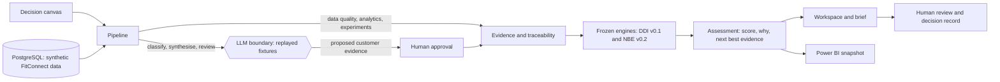
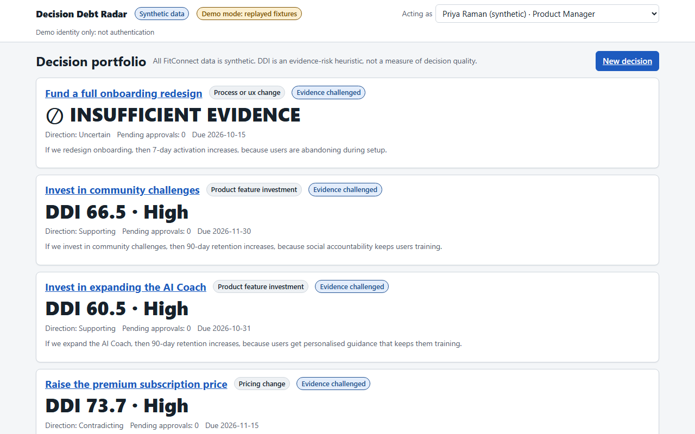
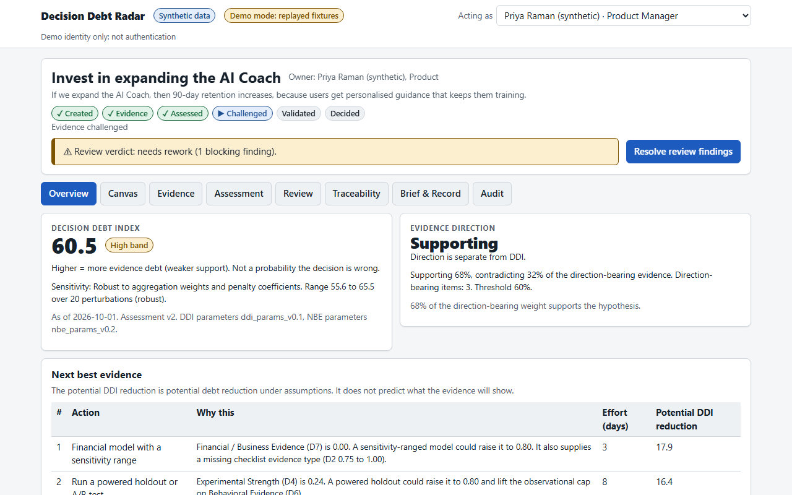
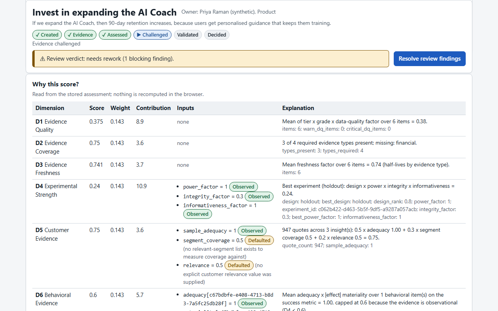
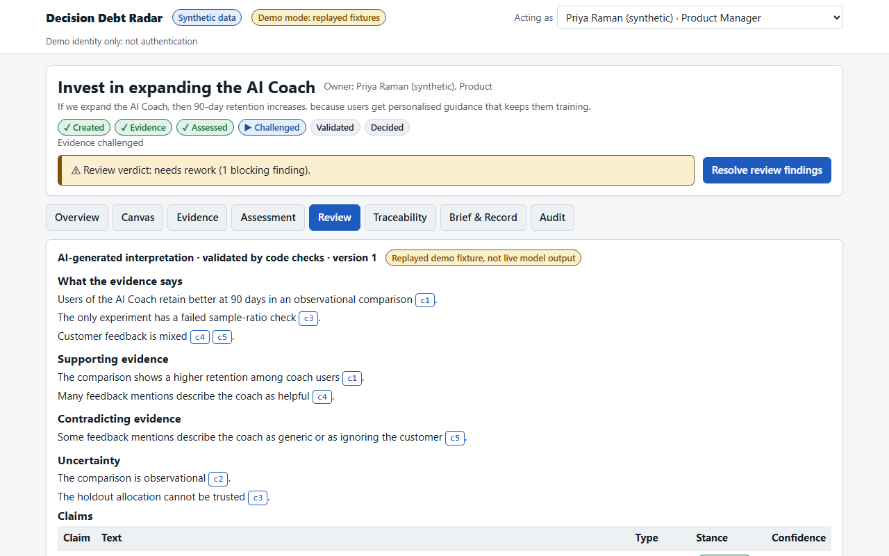
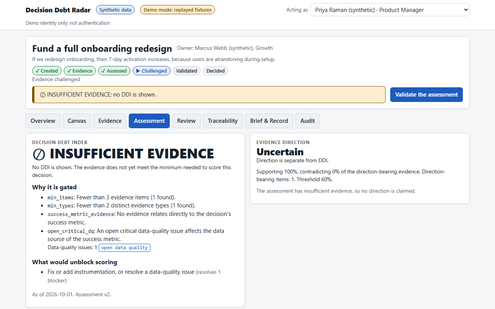
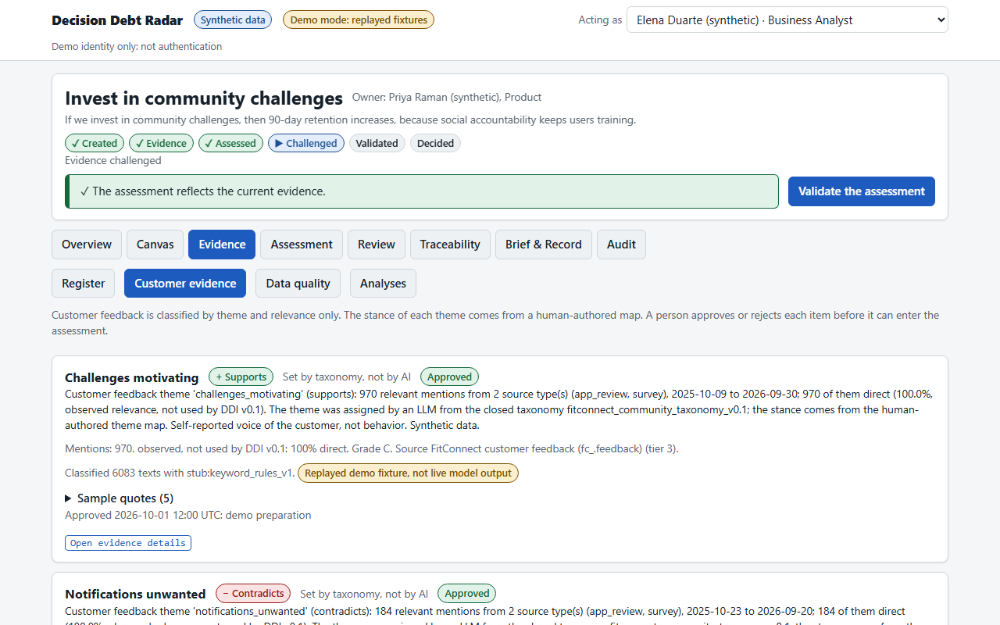

# Decision Debt Radar

**An AI deliberately constrained from making the decision.** Decision Debt Radar (DDR) scores how well an important business decision is supported by evidence, shows exactly why, says what evidence to gather next, and leaves the decision to a person.

> **Synthetic data.** FitConnect is a fictional company; all data is synthetic and generated from a fixed seed. DDI is a proposed evidence-risk heuristic: not a measure of decision quality, not validated, not an industry standard and not a predictor of outcomes.

## How it works



The engines (DDI and NBE) are deterministic code with versioned, hash-checked parameters. The model boundary can only classify customer text into a closed taxonomy, write a schema-validated synthesis that eight validators check, and review it; code derives the verdict. Nothing an LLM writes can change a score.

## Screenshots

All screenshots show **synthetic data** and the **replayed demo** (stub, not model output).

| | |
|---|---|
|  Portfolio: one headline per decision (synthetic data). |  AI Coach overview (synthetic data). |
|  "Why this score?": every dimension, input and penalty (synthetic data). |  Review tab: replayed reviewer, verdict derived by code (stub, not model output). |
|  Onboarding: INSUFFICIENT EVIDENCE, no DDI anywhere (synthetic data). |  Customer evidence: proposed until a person approves it (synthetic data). |

The validated brief is in `docs/screenshots/07-brief.png`.

## Quickstart (Windows with Git Bash; use `.venv/bin/python` on macOS and Linux)

Prerequisites: Python 3.11 to 3.13, Node 22+, Docker Desktop. Use `127.0.0.1`, never `localhost`.

```bash
cp .env.example .env                                              # local-only placeholders; .env is git-ignored
py -3.12 -m venv backend/.venv                                  # Python 3.11 to 3.13 only (3.14 is refused); macOS and Linux: python3.12 -m venv backend/.venv
backend/.venv/Scripts/python -m pip install -e "backend[dev]"
(cd frontend && npm ci)
docker compose up -d db                                           # wait until `docker compose ps` shows healthy
(cd database && PYTHONPATH="../backend;.." ../backend/.venv/Scripts/python -m alembic -c alembic.ini upgrade head)
PYTHONPATH="backend;." backend/.venv/Scripts/python scripts/demo_check.py          # preflight; on a new clone it lists what is still missing
PYTHONPATH="backend;." DDR_LLM_MODE=replay backend/.venv/Scripts/python scripts/demo_prepare.py --reset   # generate and load the synthetic data, prepare the four decisions (a few minutes)
DDR_LLM_MODE=replay DDR_AS_OF_DATE=2026-10-01 PYTHONPATH="backend;." backend/.venv/Scripts/python -m uvicorn app.main:app --host 127.0.0.1 --port 8000
(cd frontend && npm run build && npx next start -H 127.0.0.1 -p 3000)             # in a second terminal: http://127.0.0.1:3000
```

On macOS or Linux, separate the `PYTHONPATH` entries with `:` instead of `;`. No API key is needed or used. Check the result with `scripts/demo_check.py` (all PASS) and `http://127.0.0.1:8000/health` (`llm_mode: replay`).

## Honest limitations

> - **Synthetic, templated data.** FitConnect data is generated; customer feedback is 195 distinct sentences for 6,083 rows.
> - **No live model.** No API key exists and none was used. Classification, synthesis and review are *replayed* fixtures and a keyword-rule stub, marked `stub_not_model_output`. Reviewer recall and false-flag rate, real classification accuracy and live schema validity are **NOT EVIDENCED**.
> - **Replay fixtures are hand-authored**, including their deliberately injected flaws.
> - **DDI is a proposed heuristic** with proposed default parameters, not validated. Its bands are what the frozen engine returns for synthetic inputs.
> - **Known gap:** for Community the NBE does not list a segment-level analysis although the heterogeneity flag fires (the action is at its ceiling), so acceptance criterion AC-5 is only partly met.
> - The Power BI report was written as text and validated against the Desktop schemas; opening and saving it in Desktop is a separate step (see [analytics/powerbi/README.md](analytics/powerbi/README.md)).

## Evidence of what works

| Document | What it is |
|---|---|
| [docs/evaluation-report.md](docs/evaluation-report.md) | Evaluation of the deterministic engines and the pipeline: metrics, failures, NOT EVIDENCED items, how to reproduce |
| [docs/acceptance-matrix.md](docs/acceptance-matrix.md) | AC-1 to AC-43 with status (PASS, PARTIAL, NOT EVIDENCED) and linked evidence |
| [docs/demo-script.md](docs/demo-script.md) | The 5-minute demo path and what not to claim |
| [docs/spot-audit.md](docs/spot-audit.md) | Sampled claims and findings for the Product Owner's review |
| [analytics/powerbi/](analytics/powerbi/README.md) | Power BI project (PBIP) and CSV snapshot of the reporting views |
| [docs/day-7-implementation-notes.md](docs/day-7-implementation-notes.md) | Day-7 notes, deviations and the fresh-clone log |

Tests: `backend/.venv/Scripts/python -m pytest` (includes `tests/evals`), `cd frontend && npm test && npm run typecheck && npm run test:e2e` (the e2e run reseeds the database).

---

## Status

**Day 7 of 7: evaluation, Power BI, documentation and demo.** An evaluation suite (21 synthetic specs and a 22-family seeded-flaw suite, run on rolled-back transactions, with a golden snapshot of the frozen engines' observed output), the evaluation report, the acceptance matrix, a Power BI project (PBIP) over a CSV snapshot of the reporting views, a read-only demo preflight, this README and the demo script, and three small fixes: the Pricing per-dimension version comparison, the V-NUM sign check and the AC-1 wording. DDI v0.1 and NBE v0.2 are unchanged. **No live model has been called; every model-behaviour figure is NOT EVIDENCED.** See [docs/day-7-implementation-notes.md](docs/day-7-implementation-notes.md) and [docs/day-7-implementation-brief.md](docs/day-7-implementation-brief.md).

**Day 6 of 7: the Decision Workspace (product experience).** A Next.js 16 UI over the unchanged engines: portfolio, a decision workspace (overview, canvas, evidence, assessment with "Why this score?", review, traceability, brief and record, audit), a printable brief page, a demo role switcher ("Demo identity only: not authentication") and an explicit stale, gated and partial state for every panel. The frontend only displays stored values: it never computes DDI, NBE, direction, stance or permissions. A stale assessment never looks current; a gated decision shows no DDI number, band or contribution anywhere; an older scored version appears only as "vN, superseded". Backend read models N1 to N6, `DDR_LLM_MODE=live|replay|off` (default `replay`: recorded demo fixtures in `backend/demo_fixtures`, every output marked `stub_not_model_output`, shown in the UI as "Replayed demo fixture, not live model output"), and `scripts/demo_prepare.py` (real API, idempotent). Tests: pytest, Vitest and Playwright. DDI v0.1 and NBE v0.2 are unchanged. **Power BI portfolio analytics is intentionally deferred to Day 7 to keep Day 6 focused on the core Decision Workspace.** See [docs/day-6-implementation-notes.md](docs/day-6-implementation-notes.md) and [docs/day-6-implementation-brief.md](docs/day-6-implementation-brief.md).

Run the demo (no API key needed):

```bash
docker compose up -d db
PYTHONPATH="backend;." backend/.venv/Scripts/python scripts/demo_prepare.py --reset      # reseed (about 6 min) and prepare the four decisions
DDR_LLM_MODE=replay DDR_AS_OF_DATE=2026-10-01 PYTHONPATH="backend;." backend/.venv/Scripts/python -m uvicorn app.main:app --host 127.0.0.1 --port 8000
cd frontend && npm run build && npx next start -H 127.0.0.1 -p 3000                       # http://127.0.0.1:3000
cd frontend && npm test && npm run typecheck && npm run test:e2e                          # Vitest, tsc, Playwright (the e2e run reseeds)
```

**Day 5 of 7: the first LLM boundary (customer evidence, synthesis, review, brief).** On top of Day 4: Stage 3 classifies customer feedback against a closed, per-decision taxonomy (theme and relevance only) and aggregates it deterministically into **proposed** evidence; a human (BA or product analyst) approves or rejects each (decision, theme) item, and only **active** evidence enters the frozen DDI. Stage 5 writes a schema-validated evidence synthesis, eight deterministic validators run before any claim is stored, and Stage 6 is a Reviewer whose minimum severities and verdict are enforced by code. A Validated Decision Brief exists only after validation; an insufficient assessment can have a Gated Evidence Summary, labelled on every rendering. DDI v0.1 and NBE v0.2 are unchanged (test G1, zero diff against `65caec6`). **No API key exists: every test uses recorded or stub fixtures, all marked `stub_not_model_output`; no live model call has been made and the stub E1 result measures the pipeline, not a model.** See [docs/day-5-implementation-notes.md](docs/day-5-implementation-notes.md) and [docs/day-5-implementation-brief.md](docs/day-5-implementation-brief.md).

**Day 4 of 7: data and analytics foundation (deterministic, no LLM).** On top of Day 3: per-decision data-quality checks reconciled on re-run, experiment statistics (SRM, effect with CI, design power), group comparison, trend, funnel and heterogeneity analyses, evidence generated from analyses with full traceability (identity, supersede), the SQL guard with read-only execution, and a deterministic pipeline (stages 1, 2 and 4 plus the Day-3 assessment) behind `POST /decisions/{id}/pipeline-runs`. The DDI is unchanged and NBE v0.1 is preserved (a test enforces it). **Day 4.1 remediation:** NBE v0.2 (active default) adds the success-metric blocker dependency under an open critical DQ issue, and descriptive trend and funnel evidence no longer counts toward D6. See [docs/day-4-implementation-notes.md](docs/day-4-implementation-notes.md). Still no LLM, agent, frontend feature or Power BI report.

**Day 3 of 7: deterministic business-logic foundation.** On top of the Day-2 database and synthetic data: the pure DDI and NBE engines (gating, contribution breakdown, sensitivity, evidence-direction summary), versioned and hash-checked parameters, the decision lifecycle, assessment versioning, human review and decision record, SQLAlchemy models, repositories, services and the FastAPI API with a demo role switcher (`X-Demo-User`, not authentication). There is no LLM, agent, analytics, frontend feature or Power BI report yet. See [docs/day-3-implementation-notes.md](docs/day-3-implementation-notes.md), [docs/day-2-data-foundation.md](docs/day-2-data-foundation.md) (rebuild commands included) and [docs/day-1-readiness.md](docs/day-1-readiness.md).

## Documentation (source of truth)

| Doc | Purpose |
|---|---|
| [docs/PRD-v0.1.md](docs/PRD-v0.1.md) | Product requirements (revision 2) |
| [docs/DDI-spec.md](docs/DDI-spec.md) | DDI methodology and parameters |
| [docs/NBE-spec.md](docs/NBE-spec.md) | Next Best Evidence framework |
| [docs/traceability-spec.md](docs/traceability-spec.md) | Evidence Traceability Matrix |
| [docs/ERD.md](docs/ERD.md) | Data model relationships and constraints |
| [docs/decision-lifecycle.md](docs/decision-lifecycle.md) | Decision lifecycle |
| [docs/decision-canvas.md](docs/decision-canvas.md) | Decision Canvas |
| [docs/ADRs.md](docs/ADRs.md) | Architecture decisions |
| [docs/day-6-implementation-brief.md](docs/day-6-implementation-brief.md) | Day-6 decisions D6-01 to D6-05, read models N1 to N8, frontend scope, tests |
| [docs/day-6-implementation-notes.md](docs/day-6-implementation-notes.md) | Day-6 implementation notes (architecture, replay, scenario results, test counts, deviations) |
| [docs/day-5-implementation-brief.md](docs/day-5-implementation-brief.md) | Day-5 decisions D5-01 to D5-12, the PO tightenings, required tests |
| [docs/day-5-implementation-notes.md](docs/day-5-implementation-notes.md) | Day-5 implementation notes (architecture, migration 0006, hashes, fixtures, E1, deviations) |
| [docs/day-4-implementation-brief.md](docs/day-4-implementation-brief.md) | Day-4 decisions D4-01 to D4-25, O1 to O3, required tests |
| [docs/day-4-implementation-notes.md](docs/day-4-implementation-notes.md) | Day-4 implementation notes (architecture, migration 0005, hashes, methodology as built, parameter justification, expected vs observed) |
| [docs/day-3-implementation-brief.md](docs/day-3-implementation-brief.md) | Day-3 decisions R1-R14, resolutions and required tests |
| [docs/day-3-implementation-notes.md](docs/day-3-implementation-notes.md) | Day-3 implementation notes (methodology as built, parameters, migration 0004, API, tests) |

## Repository layout

```
docs/  prompts/  data/  database/  backend/  agents/  frontend/  analytics/  tests/
docker-compose.yml  .env.example  pytest.ini
```

## Run the skeleton

Prerequisites: Python 3.11–3.13, Node 22+, Docker (optional on Day 1).

```bash
cp .env.example .env            # edit locally. .env is git-ignored
```

Backend (host):

```bash
python -m venv backend/.venv
backend/.venv/Scripts/python -m pip install -e "backend[dev]"      # Windows. Use .venv/bin/python on macOS/Linux
PYTHONPATH=backend:. backend/.venv/Scripts/python -m uvicorn app.main:app --port 8000
# http://localhost:8000/health   and   http://localhost:8000/docs
```

Frontend (host):

```bash
cd frontend && npm install && npm run dev      # http://localhost:3000
```

Tests (from the repository root):

```bash
backend/.venv/Scripts/python -m pytest
```

Docker (incremental):

```bash
docker compose up -d db                  # PostgreSQL only. No schema yet (Day 2)
docker compose --profile app up --build  # also builds backend and frontend skeletons
```

## Technology

Python, FastAPI, SQLAlchemy + Alembic, Pydantic, sqlglot, pandas, scipy/statsmodels, PostgreSQL 16, Next.js + TypeScript, Docker Compose, Power BI Desktop, Anthropic SDK (Claude Sonnet primary, Opus for the Reviewer where available). Plain Python orchestration, no agent framework. CSV-only ingestion. Role-switcher instead of authentication. Local-first.
