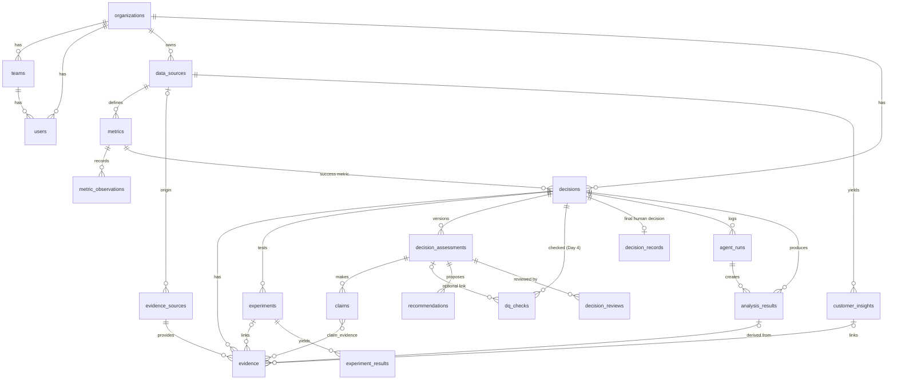

# Entity-Relationship Description

**Status:** DRAFT v0.1 (Day-1 spec, pending Product Owner approval). Parent: [PRD-v0.1.md](PRD-v0.1.md) §14.
**Canonical for:** relationships, constraints, enums, indexes and views. **Field lists and types per table are canonical in PRD §14.1** (not duplicated here, to avoid drift).

> The core schema is organization- and industry-agnostic. FitConnect raw data lives in a separate schema `fc_` and is **synthetic**. Every data-bearing table carries `is_synthetic`.

## 1. Diagram

`audit_logs` references any entity by `entity_type` + `entity_id` (no FK) and is therefore omitted from the diagram.

## 2. Tables (22)
Core: `organizations`, `teams`, `users`, `data_sources`, `metrics`, `metric_observations`, `decisions`, `decision_records`.
Evidence: `evidence_sources`, `evidence`, `experiments`, `experiment_results`, `customer_insights`.
Assessment: `dq_checks`, `analysis_results`, `claims`, `claim_evidence`, `decision_assessments`, `recommendations`, `decision_reviews`.
Operations: `agent_runs`, `audit_logs`.

Revision-2 changes to the model: **no new tables.** `decisions` gained Canvas and lifecycle columns (`lifecycle_stage`, `assessment_stale`, `decision_due_date`, `current_evidence_notes`, `change_my_mind_criteria`, `canvas_completed_at`, `canvas_locked_at`) and replaced `status`. Evidence Health is a view.

## 3. Relationships and cardinality

| Relationship | Cardinality | Notes |
|---|---|---|
| organization → teams, users, data_sources, decisions, evidence_sources, experiments, customer_insights | 1:N | All tenant tables carry `org_id` |
| data_source → metrics | 1:N | A metric is backed by one data source |
| metric → metric_observations | 1:N | |
| decision → success metric | N:1 | Required (Canvas) |
| decision → evidence | 1:N | Evidence belongs to one decision. A reused source is shared via `evidence_sources` |
| evidence_source → evidence | 1:N | |
| evidence → analysis / experiment / insight / metric | N:0..1 | At most one primary link each |
| decision → assessments | 1:N | Versioned. `unique(decision_id, version)`. The highest version is current. Lower versions are superseded (derived from `version`, no stored flag) |
| assessment → claims | 1:N | |
| claim ↔ evidence | M:N via `claim_evidence` | PK (claim_id, evidence_id) |
| assessment → recommendations, decision_reviews | 1:N | |
| decision → dq_checks | 1:N | **Day 4 (migration 0005).** A DQ check belongs to a decision: `UNIQUE(decision_id, check_key)`, updated in place on every re-run. The link to an assessment (`assessment_id`) is optional (NULL for checks generated by the pipeline) |
| decision → decision_records | 1:0..1 (MVP) | Immutable once written. `defer` records are stored with outcome `defer` |
| decision → agent_runs | 1:N | stage enum + prompt version |

## 4. Enums

| Enum | Values |
|---|---|
| `user_role` | pm, ba, product_analyst, bizops, dept_leader, executive |
| `lifecycle_stage` | created, evidence_gathered, assessed, challenged, validated, decided |
| `risk_level` | low, medium, high |
| `evidence_type` | behavioral, experiment, customer, financial, market, anecdotal |
| `stance` | supports, contradicts, neutral |
| `strength_grade` | A, B, C, D |
| `assessment_state` | scored, insufficient_evidence, partial |
| `ddi_band` | low, moderate, high, critical |
| `dq_severity` | pass, warn, critical |
| `dq_status` | open, resolved, accepted |
| `recommendation_status` | proposed, accepted, rejected, deferred |
| `review_verdict` | ready, needs_rework |
| `decision_outcome` | approve, reject, defer, approve_conditional |
| `pipeline_stage` | dq, quant, customer, experiment, synthesis, review, brief |

## 5. Constraints and integrity rules
- `decisions.success_metric_id` NOT NULL. `change_my_mind_criteria` must hold 1–5 elements (check constraint).
- `claim_evidence` requires that the claim's assessment and the evidence share the same `decision_id` (enforced by a service check and a constraint trigger if time allows).
- `claims` cannot exist without ≥1 `claim_evidence` row (enforced in the service layer inside one transaction. Documented limitation: a DB-level deferred constraint is a stretch goal).
- `decision_assessments`: `ddi_score` NULL **iff** `state ≠ scored` (check constraint). This is the database-level guarantee that no score is stored for INSUFFICIENT EVIDENCE.
- `decision_records` and `audit_logs` are insert-only (no UPDATE/DELETE grants for the application role; enforced by triggers).
- `decision_records`: partial unique index on `decision_id` WHERE `outcome <> 'defer'`. At most one final human decision per decision, while deferral records remain as history (decision-lifecycle.md LC-3).
- `claims.conclusion_ref` (text): the DDI dimension or finding a claim feeds. It populates the traceability matrix `conclusion_ref` column (traceability-spec.md §3).
- `experiments.source_ref` (text): reference to the raw experiment data within its data source (for example an experiment key). It lets the Experiment Evidence stage locate assignments and outcomes without the core schema referencing demo tables.
- `decision_assessments.params_version` NOT NULL.
- **Migration 0004 (Day 3).** `decision_assessments` gained `params_hash` NOT NULL, `nbe_params_version`, `nbe_params_hash`, `evidence_fingerprint` NOT NULL and `as_of_date` NOT NULL. `recommendations` gained `blockers_resolved integer NOT NULL DEFAULT 0 CHECK (>= 0)` (INSUFFICIENT assessments: `expected_reduction = 0`, the number of addressed blockers goes in `blockers_resolved`; the two units are never mixed).
- **Assessment immutability (trigger).** An UPDATE of `decision_assessments` that changes `decision_id`, `version`, `state`, `ddi_score`, `ddi_band`, `dimension_scores`, `penalty_scores`, `blocking_reasons`, `sensitivity`, `params_version`, `params_hash`, `nbe_params_version`, `nbe_params_hash`, `evidence_fingerprint` or `as_of_date` is rejected. Only `narrative` and `brief_md` may change.
- **Decided decisions reject every write (triggers).** INSERT, UPDATE and DELETE on `evidence`, `decision_assessments`, `recommendations`, `decision_reviews`, `dq_checks`, `analysis_results`, `claims`, `claim_evidence` and `agent_runs` are rejected when the decision's `lifecycle_stage` is `decided`. `audit_logs` stays insert-only and is still allowed.
- **Canvas edit after the lock (lifecycle guard).** When `canvas_locked_at` is set and a canvas column changes while the stage is `assessed`, `challenged` or `validated`, the guard sets `assessment_stale = true` and `lifecycle_stage = 'evidence_gathered'`. The rule lives inside `ddr_decision_lifecycle_guard`, not in a second trigger.
- **`assessed` requires an assessment row:** the guard rejects entering `assessed` unless a `decision_assessments` row with state other than `partial` exists for the decision.
- All other workflow (permissions, ordering, review and override rules) stays in the service layer.
- Read-only analytics role has SELECT on reporting views and `fc_` views only (Day 4: and, read-only, on `public.metric_observations`).
- **Migration 0005 (Day 4).** `decisions.expected_direction` NOT NULL (`increase`, `decrease`, `no_material_decrease`; it is a canvas column and joins the canvas-stale list of the lifecycle guard). `dq_checks`: `decision_id` NOT NULL, `assessment_id` nullable, `check_key` and `target` NOT NULL, `observed_value`, `threshold`, `affects_success_metric`, `source_snapshot`, `last_run_at`, `UNIQUE(decision_id, check_key)`; the decided-guard now reads `decision_id`. `experiments`: `planned_treatment_share` (> 0 and < 1), `control_variant`, `outcome_key`. `experiment_results`: `UNIQUE(experiment_id, variant)` (upsert target). `evidence`: `status` (`active` | `superseded`), `superseded_by`, `superseded_at`, `analysis_identity`, `source_fingerprint`, and a partial unique index on `(decision_id, analysis_identity)` for active items; a superseded item is never deleted and keeps both supersede fields. `analysis_results`: `analysis_identity`, `params_hash`, `source_fingerprint`; rows are historical (only `agent_run_id` may change after insert, enforced by a trigger). `v_evidence_freshness` and `v_evidence_health` count active evidence only; `v_traceability_matrix` keeps every evidence row and adds `evidence_status`.

## 6. Indexes

| Table | Index |
|---|---|
| `metric_observations` | (metric_id, observed_at) |
| `decisions` | (org_id, lifecycle_stage), (team_id) |
| `evidence` | (decision_id), (evidence_source_id) |
| `experiment_results` | (experiment_id) |
| `dq_checks` | (assessment_id), (data_source_id, status), (decision_id), unique (decision_id, check_key) |
| `analysis_results` | (decision_id), (decision_id, analysis_identity) |
| `decision_assessments` | unique (decision_id, version) |
| `agent_runs` | (assessment_id, stage) |
| `audit_logs` | (entity_type, entity_id), (org_id, ts) |

## 7. Views (reporting layer, used by Power BI)

| View | Purpose |
|---|---|
| `v_traceability_matrix` | Decision → Claim → Evidence → Source → Analysis → Conclusion, with gap rows |
| `v_debt_radar` | Portfolio: decision, team, type, lifecycle stage, DDI, band, state, robust/sensitive, last assessed |
| `v_evidence_health` | Descriptive evidence-base indicators per org × team × decision type × dimension (no composite score). Counts active evidence only (Day 4) |
| `v_evidence_freshness` | Freshness and recency detail. Active evidence only (Day 4) |
| `v_nbe_ranking` | Next Best Evidence actions with priority |
| `v_agent_quality` | Evaluation results (SQL validity, citation validity, reviewer recall) |
| Analytical views over `fc_` | Allow-listed targets for the SQL guard |

## 7a. Implementation notes (Day 2)
Implemented in `database/sql/0001`–`0005` and verified by `tests/db/`. Day-4 additions (migration `0005`, the analytics and the pipeline) are in [day-4-implementation-notes.md](day-4-implementation-notes.md). The schema name is literally `fc_`. Implementation notes are in [day-2-data-foundation.md](day-2-data-foundation.md). Day-3 additions (migration `0004`, SQLAlchemy models that mirror the live schema, a reflection test) are in [day-3-implementation-notes.md](day-3-implementation-notes.md). Every column and index in the database is documented here or in PRD §14.1.

## 8. Out of the model (future, intentionally absent)
Outcome observations, outcome attribution, post-decision re-assessment records, historical Evidence Health snapshots, canvas versioning.
